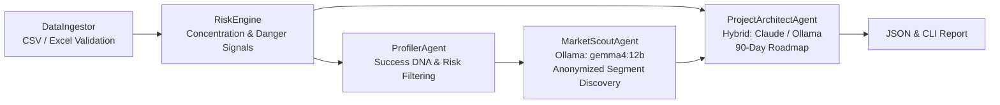

# RiskGuard: AI-Powered Portfolio Diversification Engine (RPDE)
## Risiko-Management-System zur Portfolio-Diversifizierung

---

## Project Overview | Projektübersicht

**English:**  
RiskGuard is a privacy-first multi-agent system designed to solve one of the most critical challenges for growing B2B companies: **Concentration Risk**. Many organizations inadvertently become over-dependent on a small number of high-revenue clients. RiskGuard ingests historical billing and engagement data, detects early **Danger Signals** (overdue payments, engagement drops, revenue contractions), extracts anonymized **Success DNA** from top accounts, and synthesizes a **90-day diversification roadmap**.

**Deutsch:**  
RiskGuard ist ein datenschutzorientiertes Multi-Agenten-System, das eine der kritischsten Herausforderungen für wachsende B2B-Unternehmen löst: das **Konzentrationsrisiko**. Viele Unternehmen werden unbewusst zu abhängig von einer kleinen Anzahl von Großkunden. RiskGuard analysiert historische Umsatz- und Interaktionsdaten, erkennt frühzeitig **Warnsignale** (Zahlungsverzug, sinkendes Engagement, Umsatzrückgänge), extrahiert anonymisierte **Erfolgs-DNA** aus Top-Accounts und erstellt eine **90-Tage-Diversifizierungs-Roadmap**.

---

## Key Features | Kernfunktionen

| Feature | Description (EN) | Beschreibung (DE) |
| :--- | :--- | :--- |
| **Concentration Scoring** | Calculates client revenue share and composite risk scores against a configurable threshold (default: 30%). | Berechnet den Umsatzanteil pro Kunde und einen kombinierten Risiko-Score anhand eines Schwellenwerts (Standard: 30 %). |
| **Danger Signal Alerts** | Detects active or chronic overdue invoices, >30% engagement drops, and high-value revenue contractions. | Erkennt aktive oder wiederkehrende Zahlungsverzögerungen, Engagement-Einbrüche (>30 %) und Umsatzrückgänge. |
| **Success DNA Profiling** | Isolates reliable, high-engagement growth accounts while filtering out payment-risk outliers. | Isoliert zuverlässige, stark engagierte Wachstumskunden und filtert Konten mit Zahlungsrisiko heraus. |
| **GDPR-Safe Market Scout** | Strips customer IDs before prompting local LLMs to identify adjacent target verticals. | Entfernt Kunden-IDs vor der LLM-Analyse, um benachbarte Zielbranchen datenschutzkonform zu identifizieren. |
| **90-Day Strategy Architect** | Generates a Pydantic-validated diversification plan using Hybrid AI (Cloud Claude or Local Ollama). | Generiert einen Pydantic-validierten Diversifizierungsplan über Hybrid-KI (Cloud Claude oder lokales Ollama). |

---

## Multi-Agent Architecture | Multi-Agenten-Architektur

RiskGuard orchestrates five specialized nodes in a **LangGraph** `StateGraph` pipeline with deterministic fallbacks:



### Technical Stack
* **Orchestration:** LangGraph (`StateGraph`), Python 3.12+
* **Validation & Data:** Pydantic v2, Pandas, NumPy
* **Hybrid LLM Layer:**
  * **Local (`gemma4:12b` via Ollama):** Privacy-sensitive pattern analysis and offline execution.
  * **Cloud (`claude-3-5-sonnet` via Anthropic API, optional):** Executive roadmap synthesis with automatic local Ollama fallback.

---

## Getting Started | Erste Schritte

### Prerequisites | Voraussetzungen
* **Python:** 3.12+
* **Ollama:** Running locally at `http://localhost:11434` with `ollama pull gemma4:12b`

### Installation & Execution

```bash
# 1. Clone the repository
git clone https://github.com/oprisa-de/riskguard.git
cd riskguard

# 2. Create and activate virtual environment
python3 -m venv .venv
source .venv/bin/activate

# 3. Install dependencies
pip install -r requirements.txt

# 4. Configure environment variables
cp .env.example .env

# 5. Run the full LangGraph multi-agent pipeline
python3 main.py

# 6. Run automated unit & integration tests
pytest -v
```

---

## Author | Autor

**Mihai Oprișa**  
*AI Automation Engineer | Data Analyst*  

*Disclaimer: This repository uses synthetic financial data for demonstration and architectural validation purposes. No real-world client data is stored or processed.*